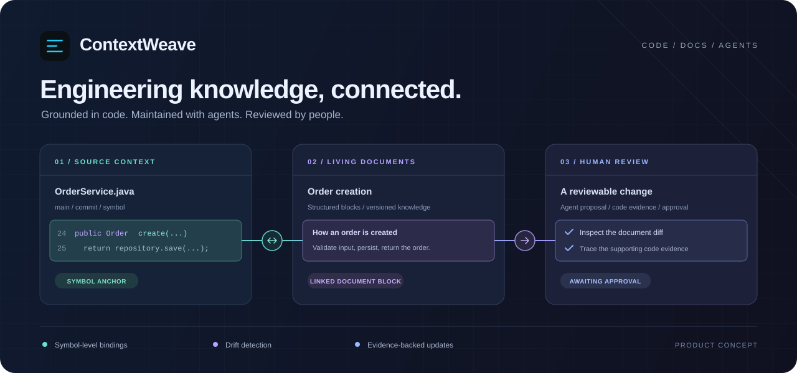
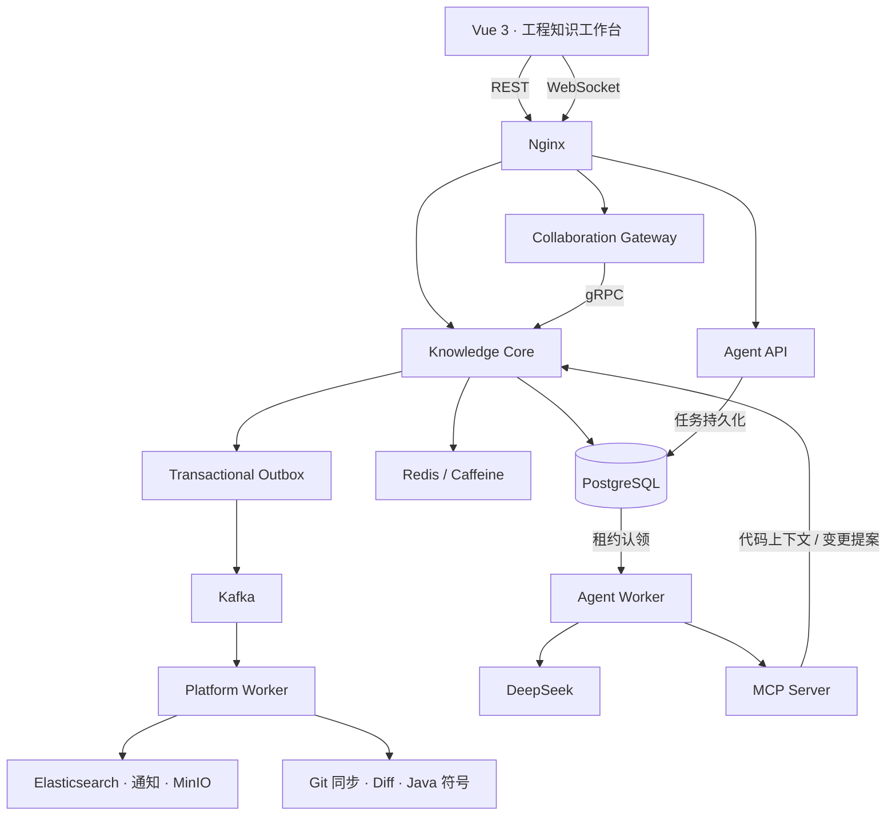

<h1 align="center">ContextWeave</h1>

<p align="center">
  <strong>让工程知识随代码持续演进。</strong><br />
  Weave code, docs, and agents into a shared engineering context.
</p>

<p align="center">
  
  
  
  
  
</p>

<p align="center">
  <a href="#为什么需要-contextweave">产品定位</a> ·
  <a href="#核心能力">核心能力</a> ·
  <a href="#系统架构">系统架构</a> ·
  <a href="#快速开始">快速开始</a> ·
  <a href="#文档与验证">文档与验证</a>
</p>



<p align="center"><sub>产品概念图，展示代码、文档与评审之间的关系；非运行界面截图。</sub></p>

**ContextWeave 是面向软件开发团队的 AI 工程知识协作平台。** 它通过符号级代码绑定，将源码、结构化文档与变更证据连接起来：团队可以从代码定位到解释它的文档，从文档回到对应实现，在代码演进时识别关联漂移，并通过 Agent 与人工评审共同维护工程知识。

项目面向 2～10 人团队，已具备文档协作、Git 知识关联、漂移检测与 Agent 文档提案的核心链路，当前处于 **Beta** 阶段。前身为 DevCollab，仓库中的服务名、包名与配置前缀沿用 `devcollab`。

## 为什么需要 ContextWeave

代码持续变化，团队对代码的理解也需要持续更新。一个方法签名的调整，可能影响接口说明；一次模块迁移，可能让架构文档中的引用失效；一份 AI 生成的文档，也需要回答“依据哪个提交、对应哪段实现、谁批准了这次更新”。

ContextWeave 围绕三个问题组织协作：

| 团队需要回答的问题 | ContextWeave 的处理方式 |
| --- | --- |
| 这段文档描述的是哪段代码？ | 将文档或 Block 绑定到文件、行范围或符号，并在工作台中双向定位 |
| 代码变了，哪些知识需要更新？ | 基于提交、Diff 与符号表重新解析绑定，识别位置、签名与引用有效性的变化 |
| 这次文档更新是否值得接受？ | 将 Agent 产出组织为带有代码证据的变更请求，由人工评审后应用 |

**一条可追踪的知识关系：代码锚点 ↔ 文档 Block ↔ 提交证据 ↔ 变更评审。**

## 核心能力

### 01 · 代码与文档，共享同一份上下文

联动工作台将源码、Code Anchor Rail 与结构化文档放在同一个视图中。点击代码范围、锚点节点或文档 Block，可联动聚焦与滚动另一侧；问题、证据和版本信息跟随当前选中对象。

- 支持 `FILE` / `RANGE` / `SYMBOL` 三类锚点，以及 `PRIMARY` / `SUPPORTING` 关联角色。
- 提供联动对照、代码聚焦、文档聚焦与漂移评审四种视图，共享选中上下文。
- 检查器可折叠，结构化编辑与实时协作保留在文档侧。

### 02 · 从代码变更，追踪知识漂移

公开 GitHub 仓库异步同步后，系统投影文件树、提交、真实 Diff、Java 符号与显式内部依赖；新版本入库时，以既有绑定为起点重新解析代码关系。

| 变化类型 | 当前处理方式 |
| --- | --- |
| 行号偏移 | 校正绑定位置 |
| 符号移动 | 更新绑定的文件路径与位置 |
| 签名变化 | 更新绑定，并在关联 Block 满足条件时替换旧签名文本 |
| 符号或文件删除 | 移除失效绑定 |

确定性修复通过变更流水留痕。符号键格式不兼容时跳过检测，避免将解析差异误判为引用失效。**当前自动修复覆盖锚点与签名文本，不代表任意自然语言描述都能自动保持语义一致。**

### 03 · Agent 起草，团队掌握发布权

Agent 以 DeepSeek 为模型后端，通过 MCP 获取代码与文档上下文，完成项目发现、模块规划、章节骨架与批次撰写。生成结果以 **Change Request** 进入人工评审。

- **先确认结构**：章节骨架获批后，才执行对应的正文批次。
- **再填充内容**：稳定槽位 ID 连接章节结构与撰写任务，降低重复创建与内容错位。
- **带着依据提交**：变更请求包含文档操作、绑定提案与代码证据。
- **有边界地修复**：校验失败后进入有次数上限的修复循环，失败不会无限调用模型。

Agent 生成内容不会自行批准或应用；上节中的确定性漂移修复走自动应用路径，两者具有不同的处理边界。

### 04 · 从共同编辑，到评审发布

文档采用 Vue 3 + Tiptap 3 的结构化 Block 编辑，覆盖需求、API、架构、数据库、前后端、测试、部署与 ADR 等九种文档类型。

- 嵌套文档树、段落 / 标题 / 代码 / 待办 Block，以及稳定的 `blockId + version`。
- WebSocket 房间、在线成员 Presence、逐操作确认与断线增量恢复。
- 草稿、评审、发布与废弃生命周期，不可变发布版本及历史快照。
- 变更前后 Diff、代码证据与版本冲突检查；过期或冲突的提案禁止覆盖人工修改。
- 工作区角色、成员邀请、评审通知、搜索与通知中心。

## 一次工程知识更新如何发生

以调整一个 Java 方法签名为例：

1. **同步代码**：管理员登记或同步仓库，Worker 获取提交、Diff 与符号信息。
2. **找到关联**：系统通过绑定定位到描述该方法的文档 Block。
3. **识别漂移**：比较新旧符号，按规则更新锚点；符合条件的签名文本同步修正并记录变更。
4. **提出补充**：需要重新解释业务逻辑时，可发起 Agent 分析，生成文档变更提案。
5. **评审发布**：团队对照正文 Diff 与代码证据接受或拒绝提案，再按文档生命周期评审发布。

这一流程支持三种日常场景：**理解现有模块、维护变更后的文档、协作评审 Agent 生成内容。**

## 系统架构

系统以 Knowledge Core 承载权限、文档、版本与变更事务，将实时连接、异步投影和模型执行分离为独立服务。



### 为一致性与可恢复性设计

| 工程关注点 | 实现机制 |
| --- | --- |
| 业务提交与异步事件一致 | Transactional Outbox，将业务数据与事件写入同一事务 |
| 消息重投与消费失败 | Consumer Inbox 幂等去重、重试与 DLQ；搜索等投影可重建 |
| 并发编辑与断线恢复 | `expectedVersion` 冲突检测、Redis Lua 去重、`APPLIED / DUPLICATE / CONFLICT` ACK 与序列增量补偿 |
| Agent 长任务恢复 | Job / Unit 两级状态机、PostgreSQL 租约认领、心跳续租、分类重试与幂等键 |
| 模型输出可控 | 结构化校验、有界修复、骨架审批门与人工应用提案 |
| 身份与访问控制 | Spring Security、JWT、HttpOnly Refresh Cookie、CSRF / Origin 校验、登录限流与工作区权限 |
| 多节点缓存协调 | Caffeine + Redis 多级缓存、Kafka 跨节点失效 |
| 运行过程可观测 | OpenTelemetry、Prometheus、Loki、Tempo、Grafana 与 Alloy 本地编排 |

### 模块划分

| 模块 | 职责 |
| --- | --- |
| [`web`](web/) | 文档编辑、代码联动、变更评审、成员、搜索与通知 |
| [`knowledge-core`](knowledge-core/) | 权限、文档、版本、评审、变更请求、Git 元数据与 Outbox |
| [`collaboration-gateway`](collaboration-gateway/) | WebSocket 连接、房间、Presence、背压与操作路由 |
| [`devcollab-grpc-contract`](devcollab-grpc-contract/) | Gateway 与 Core 的 Protobuf / gRPC 契约 |
| [`devcollab-worker`](devcollab-worker/) | Kafka 消费、搜索 / 通知 / 对象投影、JGit 同步与 Java 符号解析 |
| [`devcollab-mcp-server`](devcollab-mcp-server/) | 代码、绑定、文档结构、仓库变更查询与文档提案工具 |
| [`agent-service`](agent-service/) | FastAPI 服务与独立 Worker，负责规划、撰写、校验与提案提交 |

<details>
<summary><strong>展开 Agent 任务管线与执行边界</strong></summary>

| 单元类型 | 触发场景 | 职责 |
| --- | --- | --- |
| `PROJECT_DISCOVERY` | 登记仓库 | 扫描文件并规划语义模块，生成分析单元，不直接产出文档 |
| `SKELETON_PLAN` | 模块规划完成 | 程序生成章节骨架，提交骨架评审并创建批次任务 |
| `SEMANTIC_ANALYSIS` | 批次任务执行 | 基于槽位清单撰写文档与关联内容 |
| `CURRENT_FILE_ANALYSIS` | 当前文件分析 | 按既有绑定发现目标文档与上下文 |

骨架定义章节结构，槽位以稳定 ID 表达总览、流程与符号速查等填充目标。骨架评审处于 `PENDING` 时，正文批次等待并退避重试；`REJECTED` 或 `STALE` 时结束对应批次。

任务通过 `QUEUED → CLAIMED → RUNNING → COMPLETED / FAILED / RETRY_WAITING` 状态流转，使用 `FOR UPDATE SKIP LOCKED` 认领、租约与心跳处理并发执行。语义分析会话的修复循环默认最多两轮；任务超时、租约与最大尝试次数等预算通过 Agent 环境变量配置。

程序负责骨架、绑定契约、排版与校验；模型负责语义规划、正文撰写及根据校验反馈修复。知识库访问通过 MCP 与用户授权上下文完成。

</details>

### 技术栈

| 层级 | 技术 |
| --- | --- |
| Web | Vue 3 · TypeScript · Vite · Pinia · Element Plus · Tiptap 3 · Prism.js |
| 业务服务 | Java 21 · Spring Boot 3.5 · Spring Security · Spring JDBC · Flyway |
| 实时通信 | Spring WebFlux · WebSocket · gRPC · Protobuf |
| Agent | Python 3.12–3.13 · FastAPI · asyncpg · DeepSeek · MCP |
| 存储与事件 | PostgreSQL 17 · Redis 8 · Caffeine · Kafka 4 · Elasticsearch 8 · MinIO |
| 可观测性 | OpenTelemetry · Prometheus · Loki · Tempo · Grafana · Alloy |
| 验证工具 | JUnit 5 · Spring Boot Test · MockMvc · H2 · Vitest · Vue Test Utils · Node E2E / 基准脚本 |

## 快速开始

### 环境准备

- Java 21、Node.js（满足 Vite 7 要求）、Docker Desktop。
- 手动运行 Agent 时，需要 Python 3.12 或 3.13；默认本地编排使用容器运行 Agent。
- Java 构建使用仓库内的 Maven Wrapper。
- 如需 Agent 生成文档，在 `agent-service/.env` 中配置 DeepSeek API Key；其余变量见对应示例文件。

```powershell
Copy-Item .env.example .env
Copy-Item agent-service/.env.example agent-service/.env
```

### Windows 一键启动

在仓库根目录双击 [`start-dev.bat`](start-dev.bat)，或运行：

```powershell
.\start-dev.bat
```

启动器构建前端，启动中间件、Core / Worker / Gateway / MCP、Agent API / Worker 与可观测性组件，配置 Nginx 统一入口并执行启动验证。首次运行需要下载镜像与依赖。

启动成功后访问 **[http://localhost:8088](http://localhost:8088)**。

```powershell
# 查看运行状态
powershell -ExecutionPolicy Bypass -File tools\local-demo.ps1 status

# 停止脚本管理的服务，保留基础设施容器
powershell -ExecutionPolicy Bypass -File tools\local-demo.ps1 stop -KeepInfrastructure
```

<details>
<summary><strong>手动开发与单模块调试</strong></summary>

以下命令按需在独立终端运行；避免与启动器已运行的同名服务同时启动。

```powershell
# 根目录：启动基础设施
docker compose up -d postgres redis kafka elasticsearch minio

# 根目录：分别启动业务服务
.\mvnw.cmd -pl knowledge-core -am spring-boot:run
.\mvnw.cmd -pl devcollab-worker -am spring-boot:run
.\mvnw.cmd -pl collaboration-gateway -am spring-boot:run
.\mvnw.cmd -pl devcollab-mcp-server -am spring-boot:run
```

```powershell
# 前端开发服务器
cd web
npm.cmd install
npm.cmd run dev
```

```powershell
# Agent：在 agent-service 目录，使用 Python 3.12 或 3.13
cd agent-service
python -m venv .venv
.\.venv\Scripts\python.exe -m pip install -e ".[dev]"
.\.venv\Scripts\python.exe -m app.persistence.migrate
.\.venv\Scripts\python.exe -m uvicorn app.main:app --port 8092

# 在另一个终端的 agent-service 目录启动 Worker
.\.venv\Scripts\python.exe -m app.worker
```

Core 默认 HTTP 端口为 `8080`，MCP 为 `8091`，Agent API 为 `8092`。前端开发端口与代理见 [`web/.env.example`](web/.env.example)；服务配置见各模块的 `application.yml` 与 Agent 环境变量示例。

</details>

## 文档与验证

### 深入了解

| 入口 | 内容 |
| --- | --- |
| [文档索引](docs/00-devcollab-document-index.md) | 正式设计与专项文档的阅读入口 |
| [产品需求](docs/01-devcollab-product-requirements-v0.1.md) | 产品目标、场景与范围 |
| [系统架构](docs/02-devcollab-system-architecture-v0.3.md) | 服务边界、数据流、一致性与安全 |
| [Git 工程知识](docs/12-devcollab-git-knowledge-design-v0.4.md) | 仓库同步、Diff、Java 符号与依赖图 |
| [代码与文档协同撰写](docs/14-devcollab-code-document-authoring-design-v0.1.md) | 代码关联、受控上下文、提案与证据 |
| [变更评审设计](docs/16-devcollab-document-change-review-design-v0.1.md) | 结构化变更、版本冲突与原子应用 |
| [工作台交互规范](docs/design/code-doc-linked-workbench/DESIGN_SPEC.md) | 双向联动、锚点栏、视图与检查器 |
| [可观测性设计](docs/08-devcollab-observability-design-v0.2.md) | 指标、日志、追踪与本地故障演练 |

专项设计包含阶段性规划，实际能力范围以当前实现与下方边界说明为准。

### 验证入口

仓库提供单元测试、前端类型检查、构建检查与依赖运行环境的 E2E / 基准工具。以下命令用于本地验证，不代表每个环境都已通过验收。

```powershell
# 根目录：Java Reactor 测试
.\mvnw.cmd test

# web 目录：类型检查、单元测试与生产构建
cd web
npm.cmd run typecheck
npm.cmd run test
npm.cmd run build

# agent-service 目录：Python 测试
cd ..\agent-service
.\.venv\Scripts\python.exe -m pytest
```

运行环境就绪后，可从根目录使用专项验证工具：

| 场景 | 工具 |
| --- | --- |
| Git 仓库同步与真实 Diff | `node tools/e2e-git-repository-check.mjs` |
| 仓库 Markdown 导入 | `node tools/e2e-git-markdown-import-check.mjs` |
| WebSocket 操作与恢复 | `node tools/e2e-gateway-operation-check.mjs` |
| 项目级 Agent 链路 | `node tools/e2e-project-agent-check.mjs` |
| 可观测性与故障演练 | [`tools/`](tools/) 下的 `e2e-observability-*` 工具 |
| 性能基准 | [基准工具说明](tools/benchmark/README.md) |

正式验收口径见 [架构验证](docs/03-devcollab-architecture-verification-v0.1.md) 与 [编辑器验证](docs/11-devcollab-editor-verification-v0.1.md)。

## 当前边界与演进方向

ContextWeave 当前专注于可运行的代码—文档协作闭环，后续沿以下方向完善：

| 方向 | 当前边界 / 后续工作 |
| --- | --- |
| 仓库接入 | 已支持公开 GitHub 仓库；私有仓库凭证、GitLab Adapter、Webhook 与增量同步待完善 |
| 语言与语义覆盖 | 当前符号与依赖投影以 Java 为主；更广的语言支持与跨分析器符号契约需继续统一 |
| 漂移修复体验 | 已具备确定性修复与变更流水；专门的修复记录事后审查前端待完善 |
| Agent 知识检索与评测 | 已有文档撰写与人工评审链路；RAG、独立 Evidence Verifier 与完整评测闭环仍需按阶段推进 |
| 生产部署 | HTTPS、秘密管理、CI/CD 与多节点部署验证待完善 |

项目文档集中在 [`docs/`](docs/)。`00–89` 编号用于团队基线；`90–99` 为按规则忽略的本地学习材料。文档维护约定见 [文档治理](docs/05-devcollab-document-governance-v0.1.md)。
